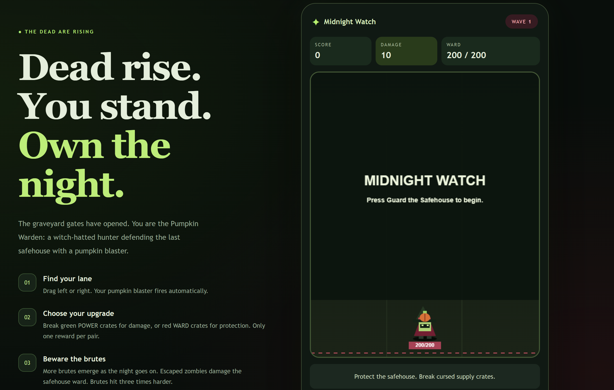

# Graveyard Rush: Midnight Watch

The graveyard gates have opened. You are the Pumpkin Warden, the last defender standing between a growing zombie horde and the safehouse.

**Graveyard Rush** is a Halloween-themed browser survival shooter. Drag to move, fire automatically, and choose between stronger attacks and better protection. Its main challenge is deciding where to aim: stop an approaching zombie, or spend a few more shots breaking an upgrade crate?

The game is designed for casual players on computers and phones, with simple controls and progressively stronger enemies.

## Play Online

**[Play Graveyard Rush](https://northwilde.github.io/Graveyard_Rush/)**

Click **Guard the Safehouse** to begin. On a computer, hold and drag inside the game area. On a phone, drag with one finger.

Audio starts after a deliberate interaction. Adjust your device volume and the in-game music settings to a comfortable level.


## How to Play

Your character shoots automatically. Move horizontally to aim at approaching zombies and supply crates.

- Defeat zombies to earn points.
- Stop enemies before they leave the bottom of the screen.
- Break supply crates to upgrade your damage or safehouse ward.
- Survive increasingly difficult waves and aim for a higher score.

There is no fixed final level. The run ends when the safehouse ward reaches zero.

### Choose Your Upgrades

Supply crates arrive in pairs, with their left and right positions randomly exchanged.

| Crate | Reward |
|---|---|
| Green **POWER** | Increases the damage of newly fired bullets |
| Red **WARD** | Increases maximum ward capacity and restores the same amount |

Only one reward can be collected from each pair. Destroying one crate removes the other. Crates that leave the screen do not damage the safehouse.

For example, collecting **WARD +50** with `80/200` ward changes it to `130/250`.

Supply pairs appear at least 12 seconds apart, with no more than one pair on screen. Their durability is adjusted using the player's damage when they appear, keeping upgrades achievable as the numbers grow.

### Survive the Horde

A new wave begins every 10 seconds. Later waves bring:

- Zombies with more health and higher breakthrough damage.
- A greater proportion of large brutes.
- More valuable upgrade rewards.

Brutes have four times the health and approximately three times the breakthrough damage of regular zombies from the same wave. Defeating one awards additional points and triggers a **BRUTE DOWN!** announcement, particles, an expanding ring and a dedicated sound effect.

Large values are abbreviated using labels such as `K` and `M`.

## Controls and Settings

| Control | Function |
|---|---|
| Mouse or touch drag | Move horizontally and aim |
| **Guard the Safehouse** | Start a run |
| **Pause / Resume** | Pause or continue |
| **Try Again** | Restart after defeat |
| **Music** | Enable or disable background music |
| **SFX** | Enable or disable shooting, upgrade and combat sounds |
| **Music volume** | Adjust background music without changing sound effects |
| **Effects** | Enable or disable particles, screen shake and related visual effects |

Restarting resets the score, damage, ward, wave progression and all active enemies and crates.

## Input, Response and Feedback

The game connects player decisions to changes in combat, supported by visual and audio feedback.

| Input or event | Program response | Feedback |
|---|---|---|
| Drag horizontally | Move the character and change where subsequent bullets are fired | Character movement and a changing firing lane |
| Hit a zombie | Subtract the bullet's damage from its health | Damage numbers and a shorter health bar |
| Destroy a supply crate | Apply its upgrade and remove the other crate in the pair | Updated statistics, a reward message and an upgrade sound |
| Defeat a brute | Award additional points | Announcement, particles, ring effect and a distinct sound |
| Let a zombie escape | Subtract its attack value from the safehouse ward | Ward reduction, damage text and an optional red border effect |
| Reach 25% ward or lower | Activate a low-ward warning | A persistent **LOW WARD** label |

The ward represents the safehouse's protection. An enemy therefore causes damage by crossing the bottom boundary, even if it does not directly touch the player.

## Run Locally

This is a static HTML, CSS and JavaScript project. It requires no package installation, build step, backend, API key, paid account or model download.

1. Download and extract the repository, or clone it.
2. Keep `index.html`, `style.css` and `game.js` in the same folder.
3. Open `index.html` in a browser.
4. Click **Guard the Safehouse**.

```text
Graveyard_Rush/
├── index.html
├── style.css
├── game.js
├── README.md
└── PROCESS.md
```

For development, the folder can also be opened in VS Code and served using a local preview tool. Save changes and refresh the browser to see updates.

The game uses **Canvas 2D** for its graphics and the **Web Audio API** for synthesized music and sound effects. The current Halloween version does not require external character images or audio recordings.

## Handling Mistakes and Interruptions

- **Leaving the window or switching tabs:** the game pauses automatically and requires an explicit resume.
- **Interrupted touch input:** pointer control is released to prevent continued movement from an inactive touch.
- **Repeated start clicks:** the start button is disabled during a run.
- **Audio unavailable:** the visual game remains playable.
- **Effects disabled:** essential numbers and text remain visible without particles or screen shake.
- **Ward depleted:** gameplay stops and **Try Again** starts a fresh run without reloading the page.

The experience currently uses pointer or touch input for movement. Audio behavior can vary between browsers and devices.

## Project Files

| File | Purpose |
|---|---|
| `index.html` | Page structure, story introduction, statistics and controls |
| `style.css` | Green, red and black visual theme, layout and mobile styling |
| `game.js` | Game state, input, shooting, collisions, progression, graphics and audio |
| `README.md` | Project overview, instructions and credits |
| `PROCESS.md` | Design decisions, AI assistance, user-trial observations and revisions |

## Design and Development

I directed the game's concept, visual theme and core mechanics, and refined the experience through implementation, debugging and repeated playtesting.

I chose a Halloween setting with a green, red and black palette. Automatic shooting and horizontal dragging keep the controls accessible, while the choice between POWER and WARD upgrades adds decision-making.

Key revisions included:

- Adding increasing enemy health, attack values and upgrade rewards.
- Making brutes appear more frequently in later waves.
- Reducing supply frequency and adjusting crate durability to improve the upgrade rhythm.
- Randomly exchanging the positions of POWER and WARD crates.
- Adding damage feedback and a low-ward warning.
- Separating background music and sound-effect controls, with an independent music-volume slider.

I used VS Code to integrate and modify the code, checked errors while developing, and repeatedly played the game to evaluate changes. The project uses GitHub for version history and GitHub Pages for online access.

Further design decisions and the user-trial record are documented in `PROCESS.md`.

## AI Assistance

I used OpenAI ChatGPT/Codex to discuss implementation options, generate code and documentation drafts, explain program logic and help diagnose errors. I directed revisions based on the intended gameplay and my experience of playing the prototype, then integrated and checked the changes.

For example, I retained the choice between attack and defense upgrades while revising crate durability, supply intervals, brute frequency and audio controls. These decisions are described in `PROCESS.md`.

## Credits

- **Concept and design direction:** the project author.
- **Development assistance:** OpenAI ChatGPT/Codex.
- **Visuals:** the current character, zombies, health bars and particles are drawn in Canvas.
- **Music and sound:** synthesized in the browser using Web Audio; no downloaded commercial songs or recorded sound packs are included.
- **Typography and symbols:** system fonts and Unicode characters.
- **Gameplay inspiration:** familiar automatic-shooting and numerical-upgrade mechanics.

An earlier robot-themed prototype used an AI-generated walking sprite. The final Halloween version uses code-drawn characters instead.